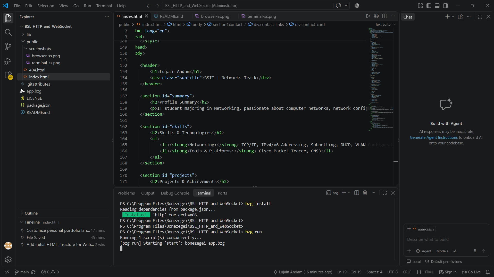
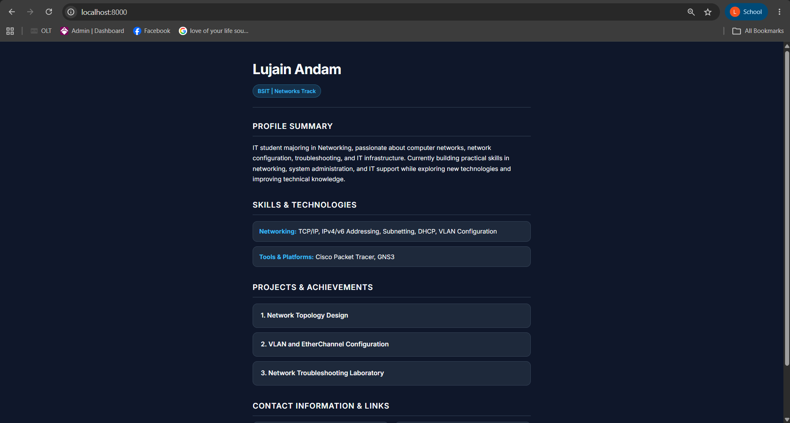

# Personal Portfolio Landing Page

## 1. Project Description
This project is a personal portfolio landing page developed for CCC181: Application Development and Emerging Technologies. The webpage introduces me, lists my skills and technologies, presents my projects, and provides my contact information.

### Technologies Used
* HTML
* CSS
* Bonezegei Scripting Language (BSL) v1.3.3
* Visual Studio Code
* GitHub

---

## 2. Setup and Execution Steps

### Prerequisites
* Bonezegei Scripting Language v1.3.3
* Visual Studio Code
* Bonezegei Scripting Language Formatter extension

### Installation
1. Download or clone the project repository.
2. Open the project folder in Visual Studio Code.
3. Open the integrated terminal in the project directory.
4. Install the project dependencies:
   ```bash
   bzg install

## Execution Verification

### Terminal Screenshot
This screenshot shows the BSL web server running successfully using `bzg run`.


### Browser Screenshot
This screenshot shows the personal portfolio website rendered in the browser.

